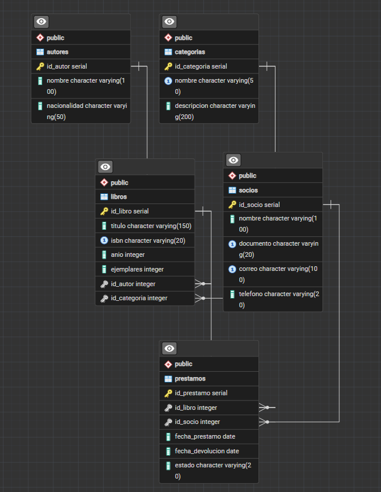
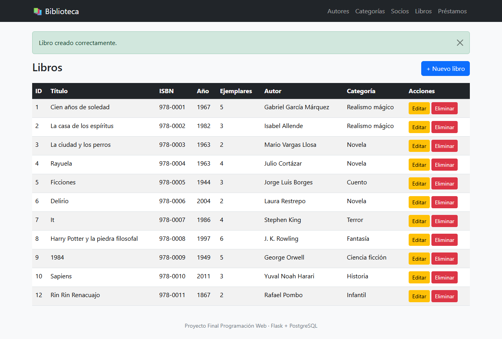
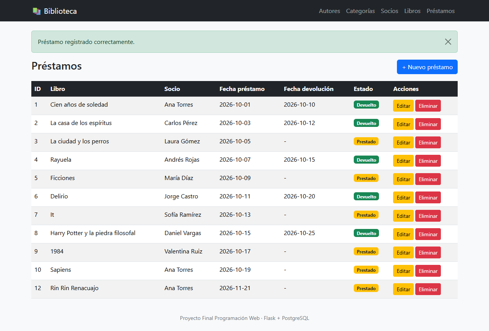

# Biblioteca

Proyecto final de Programacion Web

Hecho por: Juan David Gamboa Herrera

## De que se trata

Es una pagina para manejar una biblioteca. Se pueden registrar autores, categorias, libros, socios y los prestamos de libros. En todas se puede ver la lista, agregar, editar y eliminar.

Esta hecho con Flask, PostgreSQL y Bootstrap.

## MER



El diccionario de datos esta en docs/diccionario_datos.md y el plan de pruebas en docs/plan_pruebas.md

## Como correrlo

1. Clonar el repo

```
git clone https://github.com/juandcodeg/Biblioteca-PW.git
cd Biblioteca-PW
```

2. Crear la base de datos biblioteca_db en pgAdmin y en la Query Tool correr el backup.sql que esta en la carpeta database

3. Crear el entorno virtual e instalar lo del requirements

```
python -m venv .venv
.venv\Scripts\activate
pip install -r requirements.txt
```

4. Copiar el .env.example, ponerle de nombre .env y cambiar la contraseña por la de su postgres

5. Correr la app

```
python app.py
```

y entrar a http://127.0.0.1:5000

## Capturas





Las demas estan en docs/evidencias
