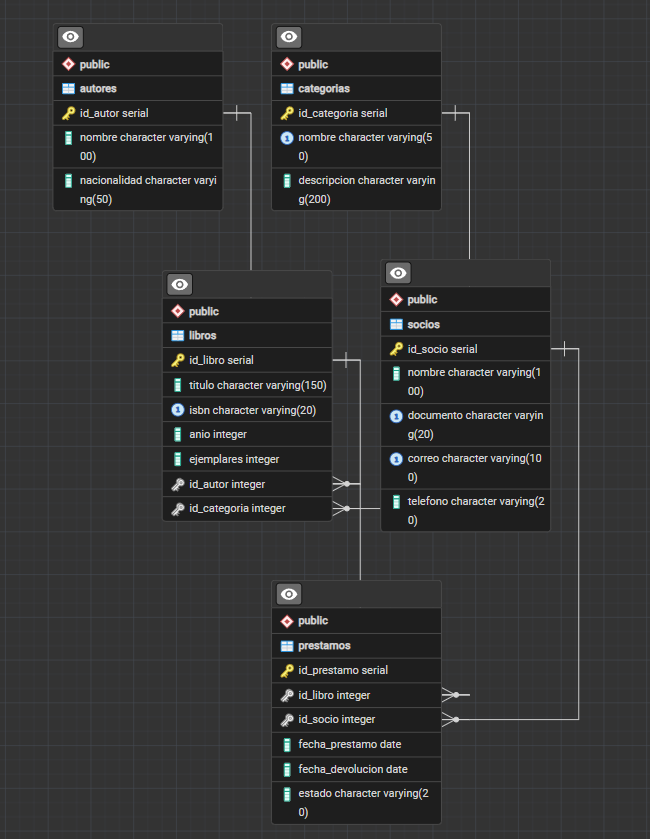

# Modelo de datos · biblioteca_db

## 1. Diagrama MER

**Relaciones y cardinalidades**

| Relación | Cardinalidad | Explicación |
|---|---|---|
| autores → libros | 1 : N | Un autor escribe muchos libros; cada libro tiene un solo autor. |
| categorias → libros | 1 : N | Una categoría agrupa muchos libros; cada libro tiene una sola categoría. |
| libros → prestamos | 1 : N | Un libro se puede prestar muchas veces; cada préstamo es de un libro. |
| socios → prestamos | 1 : N | Un socio puede hacer muchos préstamos; cada préstamo es de un socio. |

La tabla **prestamos** tiene 2 llaves foráneas (`id_libro`, `id_socio`) y la tabla **libros** también tiene 2 (`id_autor`, `id_categoria`).

## 2. Justificación de la normalización

- **1FN (Primera Forma Normal):** cada columna guarda un solo valor (no hay listas como "autor1, autor2") y cada tabla tiene llave primaria (`id_...`).
- **2FN (Segunda Forma Normal):** está en 1FN y todas las llaves primarias son de **una sola columna** (SERIAL), así que ningún dato depende de "una parte" de la llave.
- **3FN (Tercera Forma Normal):** está en 2FN y ningún dato depende de otro dato que no sea la llave. Por ejemplo, en `libros` no guardamos el nombre del autor ni la nacionalidad, solo `id_autor`; el nombre vive en `autores`. En `prestamos` no guardamos el título del libro ni el nombre del socio, solo sus `id`. Así no hay datos repetidos.

## 3. Diccionario de datos

### autores

| Campo | Tipo | Restricciones | Descripción |
|---|---|---|---|
| id_autor | SERIAL | PK | Identificador del autor |
| nombre | VARCHAR(100) | NOT NULL | Nombre completo del autor |
| nacionalidad | VARCHAR(50) | NOT NULL | País de origen del autor |

### categorias

| Campo | Tipo | Restricciones | Descripción |
|---|---|---|---|
| id_categoria | SERIAL | PK | Identificador de la categoría |
| nombre | VARCHAR(50) | NOT NULL, UNIQUE | Nombre de la categoría (no se repite) |
| descripcion | VARCHAR(200) | — | Descripción corta |

### socios

| Campo | Tipo | Restricciones | Descripción |
|---|---|---|---|
| id_socio | SERIAL | PK | Identificador del socio |
| nombre | VARCHAR(100) | NOT NULL | Nombre completo |
| documento | VARCHAR(20) | NOT NULL, UNIQUE | Documento de identidad |
| correo | VARCHAR(100) | NOT NULL, UNIQUE | Correo electrónico |
| telefono | VARCHAR(20) | — | Teléfono de contacto |

### libros

| Campo | Tipo | Restricciones | Descripción |
|---|---|---|---|
| id_libro | SERIAL | PK | Identificador del libro |
| titulo | VARCHAR(150) | NOT NULL | Título del libro |
| isbn | VARCHAR(20) | NOT NULL, UNIQUE | Código ISBN |
| anio | INTEGER | NOT NULL, CHECK (1000 a 2100) | Año de publicación |
| ejemplares | INTEGER | NOT NULL, CHECK (>= 0) | Cantidad de copias |
| id_autor | INTEGER | NOT NULL, FK → autores | Autor del libro |
| id_categoria | INTEGER | NOT NULL, FK → categorias | Categoría del libro |

### prestamos

| Campo | Tipo | Restricciones | Descripción |
|---|---|---|---|
| id_prestamo | SERIAL | PK | Identificador del préstamo |
| id_libro | INTEGER | NOT NULL, FK → libros | Libro prestado |
| id_socio | INTEGER | NOT NULL, FK → socios | Socio que pide el libro |
| fecha_prestamo | DATE | NOT NULL | Día del préstamo |
| fecha_devolucion | DATE | CHECK (>= fecha_prestamo) | Día de devolución (vacío si no ha devuelto) |
| estado | VARCHAR(20) | NOT NULL, CHECK ('Prestado' o 'Devuelto') | Estado del préstamo |
